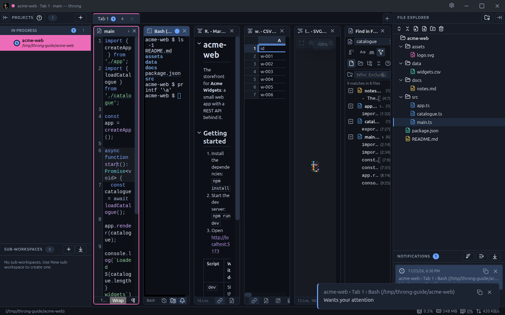

# Knowing when something needs you

A dozen jobs running at once helps only if you can leave them alone. throng marks the panels that need
you, and can tell you outside the window, so you can get on with something else. What raises a mark is
under [Attention](../../docs/preferences.md#attention), and how each notice is announced under
[Notifications](../../docs/preferences.md#notifications).

## See which panels need you

**Panel headers, tabs, the Projects pane**

A panel that needs you carries an attention mark, and so does everything above it: its tab, its project and its category. You can see from the Projects pane which project has work waiting.

1. Look for the attention mark: a blinking circle on a panel that needs you.
2. Follow it up: its tab, its project (in place of the colour dot) and, if folded away, its category carry
   one too, with a count of the panels waiting underneath.
3. Rest the pointer on a project's or category's mark to see which panels they are, and what failed.

## Choose what raises a mark

**Cog menu › Settings › Terminal › attention signals**

A terminal can raise a mark for several kinds of event. You choose which ones count, so a mark means something you care about.

1. Open the cog menu and choose **Settings**.
2. Go to **Terminal** and find the attention signals.
3. Tick the ones you want: a program exited, a command finished, the bell, a program's own notification,
   progress, unseen output or quiet output.

## Get notified when Claude Code needs you

**Claude Code › /config › Local notifications**

Claude Code tells its terminal when it finishes a task or waits for your permission, though only in the terminals
it recognises. throng is not on its list, so with its default setting Claude Code sends nothing and the panel
stays unmarked. Pick a notification type in Claude Code and throng marks the panel each time it asks for you.

1. In a terminal running Claude Code, type `/config`.
2. Set **Local notifications** to **iTerm2**. The name is the kind of notification, and it works in throng on
   every system. Claude Code then sends a desktop notification with its message whenever it needs you, and
   throng marks the panel and shows the message in its notice.
3. Leave throng's [Program notification](../../docs/preferences.md#terminals.attention.signals.notification)
   attention signal on (it starts on).

To have a bell instead, with no message, choose **Terminal bell** and keep throng's
[Bell](../../docs/preferences.md#terminals.attention.signals.bell) signal on.

> [!TIP]
> The setting is `preferredNotifChannel` in Claude Code's own settings, so you can set it once in
> `~/.claude/settings.json` as `"preferredNotifChannel": "iterm2"` for every project.

## Jump to the next panel that needs you

**Anywhere (Ctrl+Shift+Alt+G)**

One chord takes you to the next marked panel, in whichever project it sits, and throng switches project for you.

1. Press **Ctrl+Shift+Alt+G**. throng switches project if it needs to and focuses the panel.
2. Press it again for the next one.

You can also right-click a marked project and choose **Go to Next Marked Panel**.

## Flag a panel as a reminder

**Right-click a panel › Flag**

A flag is a mark you set yourself, a reminder to come back to a panel. It raises no notification.

1. Right-click the panel's header.
2. Choose **Flag**.

It stays marked, with no notification, until you have left it and come back to it. To clear a mark sooner, open
the same menu and choose **Unflag**.

## Silence one terminal

**The terminal's status bar › Terminal notifications**

A chatty terminal can stop raising marks and notices on its own, while every other terminal carries on.

1. Click **Terminal notifications** on the terminal's status bar (or turn it off in the panel header's menu).
2. It greys out with a line through it. That terminal no longer raises marks or notices.

## Read and act on notifications

**The toasts in the corner of the window**

A toast appears in the corner when something happens, and a click on it takes you to the panel it is about.

1. Read the toast. It leaves after a few seconds, unless the pointer or focus is on it.
2. Click it to go to its panel.
3. Press **Ctrl+Shift+Alt+V** to move focus to the newest notice from the keyboard.

## Keep, order and clear the Notifications panel

**The Notifications panel at the bottom of the right pane**

The Notifications panel keeps the notices you have not dismissed, across restarts, so you can catch up on what happened while you were away.

1. Open the **Notifications** panel. Each notice names its project, tab and panel.
2. Click **Copy** on one to copy its text.
3. Dismiss them one by one, or click **Dismiss all**.

## Get notified outside throng

**Cog menu › Settings › Notifications**

throng can raise an OS notification when it is not the focused app, so you hear about a finished job while you work in another program.

1. Open [Notifications](../../docs/preferences.md#notifications) in Settings.
2. Turn on the OS notification. On Windows you can also have a count on throng's taskbar icon.

## Choose what each kind of notice does

**Cog menu › Settings › Notifications**

Each kind of notice can show as a toast, stay in the Notifications panel, do both, or do neither.

1. Open [Notifications](../../docs/preferences.md#notifications) in Settings.
2. For errors, warnings, information and successes, choose a toast, the Notifications panel, both or
   neither.

> [!NOTE]
> Whatever you choose, throng still writes every event to the log, ready for a bug report.
