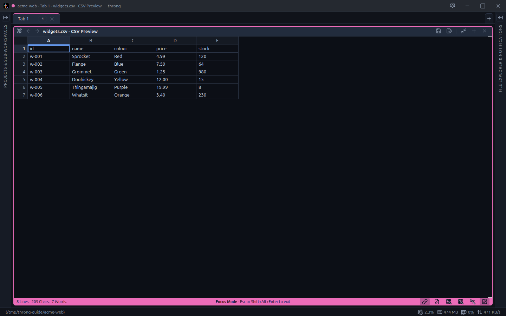

# CSV files and spreadsheets

CSV files open in a grid you can edit, so you never count commas again. Workbooks from Excel, LibreOffice
and Numbers open in a read-only preview, every sheet of them. CSV settings are in the
[CSV reference](../../docs/preferences.md#csv).

## Edit a CSV file as a grid

**File Explorer › click a `.csv` file**

The **CSV Preview Editor** shows a CSV file as a table of cells. It is the same document as the text
editor: the same unsaved marker, Save, Undo and Auto Save. A save rewrites only the fields you changed, so
your diffs stay small.

1. Click the CSV file in the File Explorer. It opens in the **CSV Preview Editor**.
2. Edit cells as you would in any spreadsheet.
3. Save with **Ctrl+S**.

## Move around and edit cells

**The CSV grid**

You can work through a table from the keyboard alone. The arrow keys move the selection, and a cell you
start editing keeps the arrows for its own caret until you finish.

1. Move with the arrow keys, or press **Tab** and **Shift+Tab** to step across a row and on to the next or
   previous one.
2. Press **Enter** or **F2**, or double-click, to edit a cell.
3. Press **Delete** to clear it.

## Insert rows and columns

**The CSV grid › right-click a cell, row number or column letter › Insert**

The **Insert** submenu adds empty rows and columns where you need them, or inserts ones you copied from another
grid.

1. Right-click a cell, a row number or a column letter, and open **Insert**.
2. Choose above, below, left or right, or the rows or columns you copied. **Rows Above…** and the other counted
   inserts ask how many to add, in a box over the grid that you answer or close with Esc before you go on.

To add a row at the end, type into the empty row below the last one. It joins the file only once you type or paste
into it, and a new empty row appears under it.

A new, empty CSV takes inserted rows and columns too, before it holds any data: each one is written as a line of
empty fields, separated by commas.

To remove rows or columns, select them by their numbers or letters, right-click the numbers or letters, and choose
**Delete Row** or **Delete Column**. **Clear Cells** on the same menu empties them and keeps the rows and columns. A file always keeps at least one
column; delete its rows to empty it.

## Copy and paste cells

**The CSV grid › Ctrl+C / Ctrl+V**

Cells copy as tab-separated text, the format other spreadsheets read, so data moves both ways between throng
and Excel or LibreOffice.

1. Select the cells and copy them.
2. Paste where you want them.
3. To empty a selection, press **Delete** or choose **Clear Cells**.

**Copy as** on the same menu copies as rich text or plain text, whatever the copy format setting says. Undo and
Redo sit just below the clipboard rows. Right-click the corner where the row numbers meet the column letters for
the menu of the whole table.

## Set column widths and edit long cells

**The CSV grid › column letters and row numbers**

A column can fit its widest value, or take a width you set. A cell too long to read in the grid opens in a
dialog of its own, with a JSON value laid out on several lines.

1. Double-click a column letter to fit it to its content.
2. Or right-click it and set **Column Width**.
3. A long cell opens in a cell dialog for editing.

## Keep headers in view and wrap text

**The CSV grid's menu**

In a big table you can hold the first row and column in place while the rest scrolls, and wrap long text so
each cell shows in full.

1. Lock the first row and the first column, so they stay put as you scroll.
2. Turn on **Wrap** to see long text in full.

## Fix a CSV that will not parse

**The notice a broken CSV opens**

A stray quote can unbalance every field after it. When that happens, throng opens a notice naming the line
where the quotes stop balancing.

1. Read the notice for the line number.
2. Click **Open in Editor** and fix that line.

## Read a spreadsheet

**File Explorer › click a workbook**

The spreadsheet preview opens Excel, LibreOffice and Numbers workbooks without another program. It shows
every sheet, with a switcher along the bottom.

1. Click the `.xlsx`, `.xls`, `.ods` or `.numbers` file (or one of their relatives).
2. Switch sheets with the switcher along the bottom.

> [!NOTE]
> Workbooks are read-only, and their values are drawn in a muted colour to show it. Select and copy cells, and
> paste them into a CSV to work on them. Formula cells show their stored values; throng recalculates nothing.
