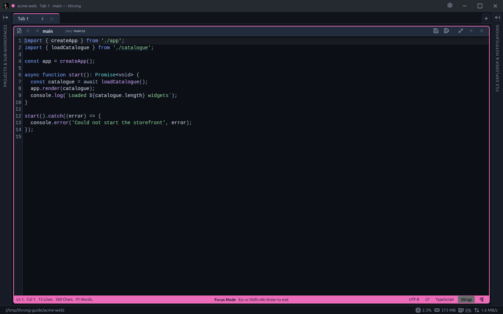

# Editing

throng's editor colours 55 languages, keeps one document per file however many panels show it, and holds
on to your unsaved work through a crash. It makes no attempt to be a full IDE. It is the editor you want
right next to the terminal that's running the code. Its settings
are in the [Editor reference](../../docs/preferences.md#editor) and its shortcuts under
[Editor bindings](../../docs/key-bindings.md#editor).

## Save your work

**An editor › Ctrl+S**

Saving writes the document to disk and clears its unsaved dot from the panel, the tab and the project.

1. Press **Ctrl+S** to save the file you are in.
2. Press **Ctrl+Shift+S** to save every open file, or **Ctrl+Alt+S** to save as a new file.

A dot marks unsaved changes on the panel, its tab and its project. Auto-save is an
[Editor setting](../../docs/preferences.md#editor).

## Close or switch files with unsaved changes

**Closing a panel, tab or project**

Closing a panel, tab or project with unsaved changes asks first, and names each document it would lose.

1. Close the panel, tab or project as usual.
2. If anything in it is unsaved, throng asks first: save, discard or cancel.

To throw your changes away, choose **Revert** from the panel header's menu.

## Set the language of a file

**The editor's status bar › language picker**

throng picks a file's language from its name. The status bar shows the language and lets you change it for a file throng guessed wrong.

1. Click the language name on the editor's status bar.
2. Pick the language you want.
3. Changed your mind? Choose **Reset Language** to hand the file back to detection.

throng recognises files by name as well as extension: `Dockerfile`, `.env`, `.gitignore`, and
`tsconfig.json` as JSON with comments. Map your own extensions in
[Languages](../../docs/preferences.md#languages).

## Indent, and control tabs and spaces

**An editor › Tab / Shift+Tab**

The editor keeps each file's indentation the way it was written: tabs or spaces, and how many.

1. Select the lines.
2. Press **Tab** to indent or **Shift+Tab** to outdent.

throng detects each file's indentation for you. Set rules per language in
[Indentation](../../docs/preferences.md#indentation).

## Edit several places at once

**An editor › Ctrl+click, or Alt+drag**

Multiple cursors let you change repeated text in one go, typing in several places at once.

1. **Ctrl+click** (macOS: **Cmd+click**) to add a cursor wherever you click.
2. Or **Alt+drag** (macOS: **Option+drag**), or press **Shift+Alt+Arrow**, to select a column.
3. Type: every cursor types at once.

## Cut and copy whole lines

**An editor › Ctrl+X / Ctrl+C with nothing selected**

With nothing selected, cut and copy take the whole line the cursor sits on.

1. Put the cursor on the line.
2. Press **Ctrl+X** to cut the whole line or **Ctrl+C** to copy it.
3. Paste it wherever it belongs.

## Wrap lines and show invisible characters

**An editor › Ctrl+E,W, or the status bar › View Whitespace**

Word wrap fits long lines to the panel. View Whitespace draws a symbol for every space, tab and line break, so stray tabs and trailing spaces show.

1. To wrap long lines, hold **Ctrl**, press **E**, then **W**. Do it again to unwrap.
2. To see every space, tab, line break and invisible character, click **View Whitespace** on the status bar.

## Change encoding or line endings

**The editor's status bar › encoding and line-ending indicators**

The status bar shows each file's encoding and line endings, and changes either.

1. Click the encoding on the status bar to reopen the file in another encoding, or to save it in one.
2. Click the line endings to convert the whole file to LF, CR or CRLF in one step.

> [!TIP]
> If a file looks misread, throng shows a notice and suggests its code page. **Convert to UTF-8** fixes it for
> good. UTF-16 and the Windows code pages open and save in their own encoding.

## Fold Markdown sections

**A Markdown editor › the gutter arrows, or Ctrl+M chords**

Folding a Markdown file's sections leaves its headings in view, so you see a long document's outline.

1. Click the arrow in the gutter beside a heading to fold or unfold its section. A folded section shows **…** after
   its heading; click that to unfold it too.
2. Or use the **Outlining** submenu on the right-click menu. Each row shows its key.
3. Or keep your hands on the keyboard: hold **Ctrl**, press **M**, then **S** to collapse the section the caret is in,
   **E** to expand it, **A** to collapse all and **X** to expand all. Add **Shift** to S or E to act on everything
   inside the section. The full list is in [Markdown bindings](../../docs/key-bindings.md#markdown).

An editor and its preview fold together.

## Jump to a line

**An editor › Ctrl+G**

Go To Line moves the cursor to a line number, such as the one in an error message.

1. Press **Ctrl+G**. The Go to dialog says where you are, such as "Line 3 of 120".
2. Type the line number and press **Enter**.

## Follow links in your files

**An editor › Ctrl+click a link**

The editor finds links and file paths in your text. Ctrl+click follows one to the web page, the file, or the line it names.

1. Hold **Ctrl** (macOS: **Cmd**) and click a path or URL.
2. Or put the caret on it and press **Ctrl+Enter**.
3. Right-click a link for every other place it could open. For a file or folder, **Open In** lists the same places
   as the File Explorer's **Open In** for that file.

## Go back to where you were

**An editor › Alt+Left / Alt+Right**

Each editor panel keeps a Back and Forward history of the files it has shown.

1. Press **Alt+Left** (macOS: **Cmd+[**) or the mouse's back button to go back.
2. Press **Alt+Right** (macOS: **Cmd+]**) or the forward button to go forward again.

Each panel remembers the files it has shown, across restarts.

## Read the editor status bar

**The bar along the bottom of an editor**

The status bar along the bottom of an editor shows where the caret is, how long the document is, and where a hovered link goes.

1. Read the caret's line and column, and the size of the selection.
2. Read the document's lines, characters and words.
3. Hover a link to see its target there, and use **Open Preview** to preview the file.

## When a file changes on disk or goes missing

**The notice above the editor**

throng watches each open file on disk. When another program changes, moves or deletes it, the editor tells you and keeps your unsaved work.

1. When the file changed on disk, a notice appears: click **Reload from disk** to take the new version.
2. When the file is missing, moved or replaced, a notice above the text names what happened. Your unsaved work stays.

## Get your work back after a crash

**Reopen throng**

throng keeps a copy of unsaved work as you type, so a crash loses none of it. The next start puts it back.

1. Reopen throng after a crash.
2. Your unsaved edits are back where you left them.

Keeping the undo history across restarts too is an [Editor setting](../../docs/preferences.md#editor).

## Open the same file in two panels

**Open the file again in another panel**

Two panels can show one file, each scrolled to its own place.

1. Split the panel (see [Split a panel](layout.md#split-a-panel)).
2. Open the same file in the new panel.

Both panels show one document with one undo history, so an edit in either is an edit in both.

## Print a file

**An editor › Ctrl+P**

An editor prints through the same Print Preview as a preview, or saves a PDF.

1. Press **Ctrl+P**. Print Preview opens, unsaved changes included.
2. Choose a printer or **Save as PDF**, then print.

See [Print a preview or save it as a PDF](previews.md#print-a-preview-or-save-it-as-a-pdf) for the options.
