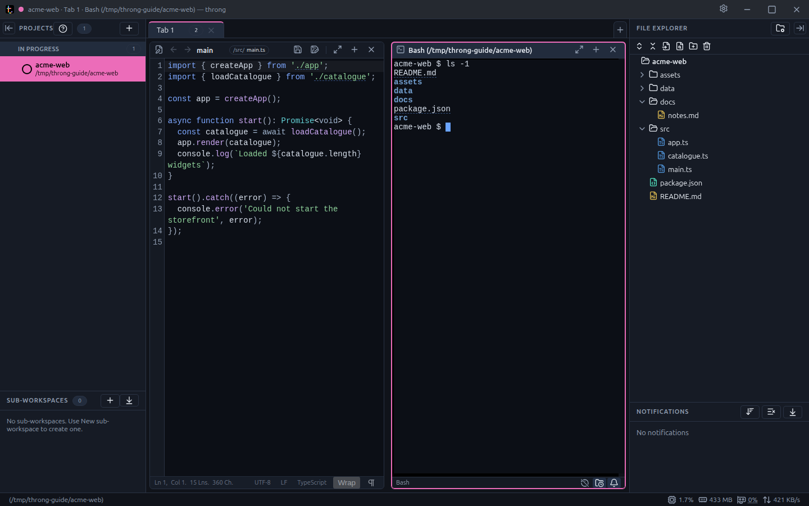
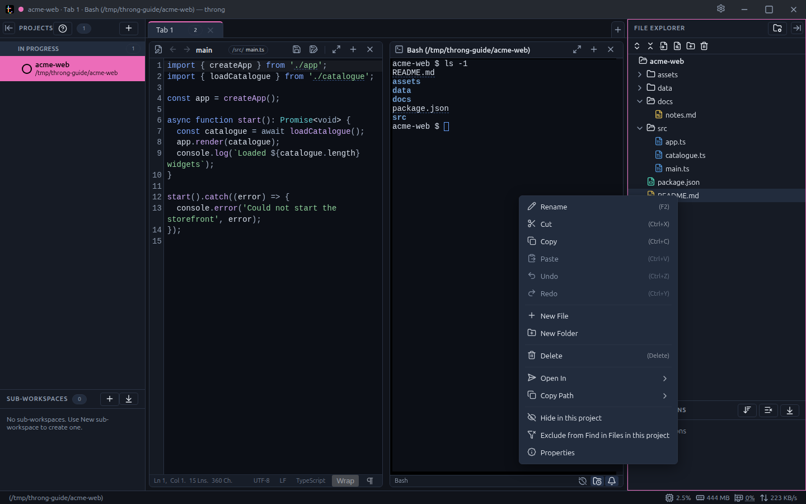

# Files

The File Explorer on the right shows the active project's files and keeps in step with the disk, so a
file another program writes turns up on its own. It does the usual file-manager jobs (create, rename,
move, copy, delete, undo) and a few your file manager doesn't. Its settings are in the
[File Explorer reference](../../docs/preferences.md#file-explorer).

## Browse your project's files

**File Explorer (right pane), or anywhere (Ctrl+Shift+Alt+M)**

The File Explorer shows the active project as a tree, from its root folder down. It works from the keyboard as well as the mouse.

1. Click a folder's arrow, double-click it or press **Enter** to expand or collapse it.
2. Move up and down with the arrow keys.
3. Rest the pointer on an item to see its full path.

The tree updates as files change on disk. It can follow the editor you are working in with the
[Follow the active editor](../../docs/preferences.md#file-explorer) setting, and the preview you are looking at
with **Follow the active preview**. Both are on unless you turn them off.

## Select several files

**File Explorer**

A selection of several items moves, copies or deletes as one batch, and undoes as one step.

1. Click the first item.
2. **Ctrl**-click to add more one at a time, or **Shift**-click to take a whole range.

## Open a file

**File Explorer › click a file, or Enter**

Opening a file puts it in an editor or a preview, by its type's default open action, and leaves the keyboard in the tree.

1. Select the file.
2. Click, double-click or press **Enter**. You choose which clicks open a file in the
   [File Explorer settings](../../docs/preferences.md#file-explorer); **Enter** works whatever you choose.
3. The panel it opens in flashes, and the keyboard stays in the tree so you can keep going.

A file throng cannot show as text opens in your OS program instead.

## Create, rename and delete files and folders

**File Explorer › right-click**

The File Explorer's menu creates, renames and deletes files and folders, so you shape the project without leaving throng.

1. Right-click a folder and choose **New File** or **New Folder**. For a folder, you can also select where it goes and
   press **Ctrl+Shift+N**.
2. Select an item and press **F2** to rename it.
3. Press **Delete** to delete it.

> [!NOTE]
> Delete sends to the Recycle Bin or Trash, or deletes for good, by the
> [Delete files to](../../docs/preferences.md#file-explorer) setting.

## Move or copy files by dragging

**File Explorer › drag**

Dragging moves or copies items between folders, and dropping a file on a panel opens it there.

1. Drag the items to their new folder. The pointer shows whether the drop will copy or move.
2. Hold the copy or move key, before or during the drag, to change it.
3. Drop a file on a panel to open it there, or on a terminal to type its path.

## Cut, copy and paste, including between projects

**File Explorer › Ctrl+X / Ctrl+C, then Ctrl+V**

Cut, copy and paste work across projects, so a file moves from one project to another with no trip through your file manager.

1. Cut or copy in one project.
2. Switch to the other project and select the destination folder.
3. Paste. The **Paste** menu item names what will land and where it came from.

Press **Esc** to cancel a pending cut. An editor open on a file you moved stays put, read-only, and names where
the file went; **Save As** keeps any unsaved text.

## Choose what happens when a name already exists

**The clash dialog that a paste or drop opens**

When a paste or drop meets a name that already exists, throng asks what to do before it writes anything.

1. Choose **Replace**, **Skip** or **Keep both**.
2. Tick **Apply to all** to answer the same way for the rest.

A replaced item goes to the Recycle Bin, unless
[When Paste replaces an item](../../docs/preferences.md#file-explorer) says otherwise.

## Follow and cancel a large paste

**The progress bar a large paste shows**

A large paste shows its progress and can stop part-way, with a choice of what to keep.

1. Watch the progress bar: a paste over 5 MB that takes more than a moment shows one.
2. Click its cancel button to stop.
3. Choose whether to keep what has already landed, or roll the whole paste back.

## Undo and redo file changes

**File Explorer › Ctrl+Z / Ctrl+Y**

The File Explorer keeps an undo history of moves, renames and deletes for each project.

1. Click in the File Explorer.
2. Press **Ctrl+Z** to undo the last change, **Ctrl+Y** to redo it.

Each project keeps its own history, even across restarts. A delete comes back from the Recycle Bin or
Trash, and throng tells you when it cannot undo something.

## Work with your system's file manager

**File Explorer and your OS file manager**

Copy, cut, paste and drag all work between throng and your OS file manager.

1. Copy or cut in one and paste in the other, in either direction.
2. Or drag between them.

A drag out of throng always copies, so you never lose a file by dropping it in the wrong window.

## Look at a file's properties and folder sizes

**File Explorer › right-click › Properties**

The Properties dialog shows an item's size, dates and permissions, and totals a folder's size as you watch.

1. Right-click any item.
2. Choose **Properties**.

## Hide files from the tree

**Cog menu › Settings › File Explorer › Excluded globs, or right-click › Hide in this project**

Patterns hide build output and clutter from the tree, for every project or for one.

1. For every project, add patterns such as `node_modules` or `dist` to the
   [excluded globs](../../docs/preferences.md#file-explorer).
2. For one project only, right-click the item and choose **Hide in this project**.

## Start a terminal, preview or search from a folder

**File Explorer › right-click a folder**

A folder's menu starts a terminal, a preview or a search right there.

1. Right-click the folder.
2. Choose **Open In** › and a terminal or preview, **Search** › to search inside it, or **Copy Path** ›.
3. **Expand All Children** and **Collapse All Children** open or fold everything beneath it.

## When a file will not move, rename or delete

**The notice throng shows**

When a file will not move, rename or delete, throng's notice names what holds it.

1. Read the notice: a throng terminal, another program, permissions, or macOS privacy settings.
2. Close or change whatever it names, then try again.

## Recognise files at a glance

**File Explorer**

Icons and badges in the tree show each file's kind and state.

1. Read the icon: it shows each file's kind and marks special folders.
2. A badge marks a symbolic link, and a dot marks unsaved changes.
3. A faded name is one a `.gitignore` matches, such as build output or a dependency folder, whether or not the
   project is a git repository. Editing `.gitignore` updates the fade. Without git installed nothing is faded.

Icon sets are chosen in [Themes and icons](themes-and-icons.md).
