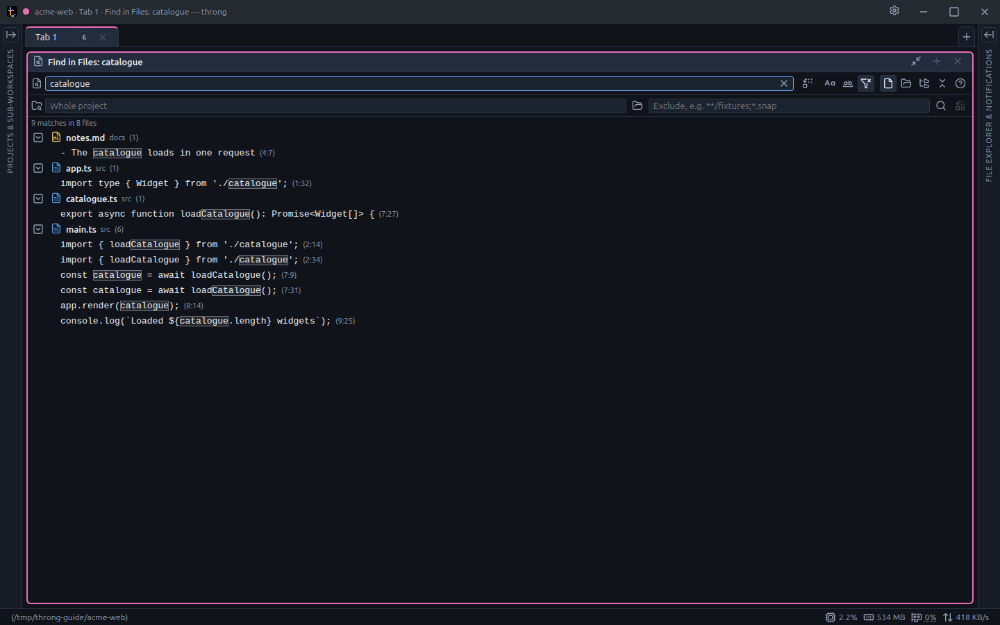

# Finding things

throng gives you three ways to find what you're after: Quick Open for a file by name, find and replace
inside one file, and a search across the whole project. Settings are under
[Search](../../docs/preferences.md#search), and shortcuts under [Search bindings](../../docs/key-bindings.md#search).

## Open any file by name

**Anywhere (Ctrl+Shift+T)**

Quick Open jumps to a file without a trip through the tree. It matches any part of a file's name or path,
so `src/app` finds `src/renderer/app.tsx`, and it ranks the closest matches first.

1. Press **Ctrl+Shift+T** to open **Quick Open**.
2. Type any part of the file's name or path.
3. Choose whether it opens in this editor or a new one, then press **Enter**.

Tick the option to include excluded files when the one you want sits in, say, `dist`.

## Find and replace in a file

**An editor › Ctrl+F / Ctrl+H**

The find bar searches the file in the focused editor. It outlines every match as you type and fills the
current one, and a replace of every match is a single undo.

1. Press **Ctrl+F** to find, or **Ctrl+H** (macOS: **Option+Cmd+F**) to find and replace.
2. Type what you are looking for. Turn on **match case** or **whole word** if you need them.
3. Step through the matches with **F3** and **Shift+F3**.
4. Replace the current match with **Alt+Enter**, or all of them with **Ctrl+Alt+Enter**.

## Find in a preview or a terminal

**A preview or terminal › Ctrl+F**

The same find bar works in a terminal's scrollback and in Markdown, HTML and PDF previews. There it finds
text and leaves the content as it is.

1. Click into the preview or terminal.
2. Press **Ctrl+F** and type.

## Search the whole project

**Anywhere (Ctrl+Shift+F)**

Find in Files searches every file in the project and lists each match in a panel of its own. Results arrive
as you type, grouped by file or by folder, and each one opens its file at the match.

The options row above the results sets how it matches: plain text, whole word, case or a regular
expression; which files it leaves out; and how it groups the results.

1. Press **Ctrl+Shift+F**. A search panel opens.
2. Type your search. Results appear as you type, grouped by file or folder.
3. Click a result to open the file at the match.

> [!TIP]
> A Markdown result opens its preview at the match when **Open Markdown files in** is set to Throng
> Preview.

## Replace across files

**Anywhere (Ctrl+Shift+H)**

Replace in Files renames something everywhere at once. You see every match before anything changes, and
you can replace one match, one file or the lot.

1. Press **Ctrl+Shift+H**. The search panel opens with its replace row showing.
2. Type what to find and what to replace it with.
3. Replace one match, one file, or everything.

> [!WARNING]
> throng warns you before a replace it cannot undo. Read that warning before you go on.

## Narrow a search

**The search panel's options, or File Explorer › right-click a folder › Search**

A search confined to one folder, or with build output left out, runs faster and gives you fewer results
to read.

1. To search one folder, right-click it in the File Explorer and choose **Search** ›.
2. Use the match options on the search panel.
3. Type patterns in **Also exclude** to leave things out of this search.

The global exclusions in [Search](../../docs/preferences.md#search) and each project's own exclusions apply
as well.
