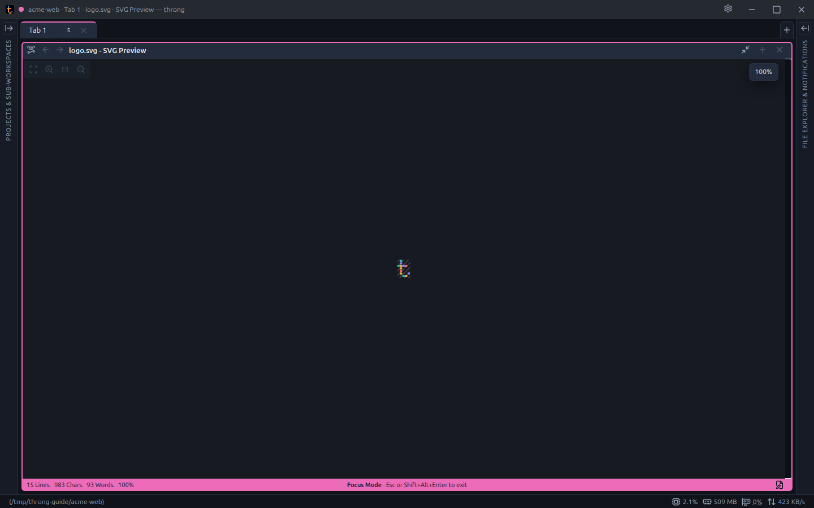

# Images, PDFs, SVG and HTML

Each of these opens in its own preview, whose title names its type, such as `logo.png - Image Preview`.
Nothing in a previewed file runs, so a dodgy download can't do anything while you look at it.

## View an image

**File Explorer › click an image**

The image preview shows PNG, JPEG, GIF, WebP, AVIF, BMP and ICO files in a panel, so you can check a picture
without opening another program. It opens fitted to the panel, and you can zoom in to see single pixels.

1. Click the image in the File Explorer.
2. It fits its panel; switch to 100% to see it pixel for pixel.
3. Zoom and pan as you would a diagram.

Transparent areas show over a hatch, so you can tell them from white.

## Read a PDF

**File Explorer › click a PDF**

The PDF preview lets you read documentation beside your work. It draws pages as you scroll to them, so a
long manual opens fast.

1. Click the PDF in the File Explorer.
2. Choose a page layout and zoom.
3. Press **Ctrl+G** to go to a page, or **Ctrl+F** to find text.

You can select text and follow links as you would in any PDF reader.

## View an SVG

**File Explorer › click an `.svg` file**

An SVG preview shows the drawing as a picture. Put it beside an editor on the same file and you see each
change to the source as you type it.

1. Click the SVG in the File Explorer. It shows as a static drawing.
2. To edit it, open it in an editor beside the preview: the preview follows your edits.

## Preview an HTML page

**File Explorer › click an `.html` file**

The HTML preview renders a page you are building in a sandbox, with its scripts switched off. It updates as
you edit the file, so you can watch the layout change.

1. Click the HTML file. The page renders in a sandbox.
2. Edit the file beside it: the preview updates as you go.
3. Links follow, **Ctrl+F** finds and **Copy** works.

## Allow remote content in an HTML preview

**The notice an HTML preview shows › Allow this source**

An HTML preview blocks the fonts, styles and images a page loads from the web, and lists what it blocked.
You choose which of those sources to trust.

1. Read the notice: it lists every source the preview blocked.
2. Click **Allow this source** for each one you trust.

> [!WARNING]
> throng adds an allowed source to the project's safe sources in [Previews](../../docs/preferences.md#previews),
> and it stays allowed. Only allow sources you trust.
