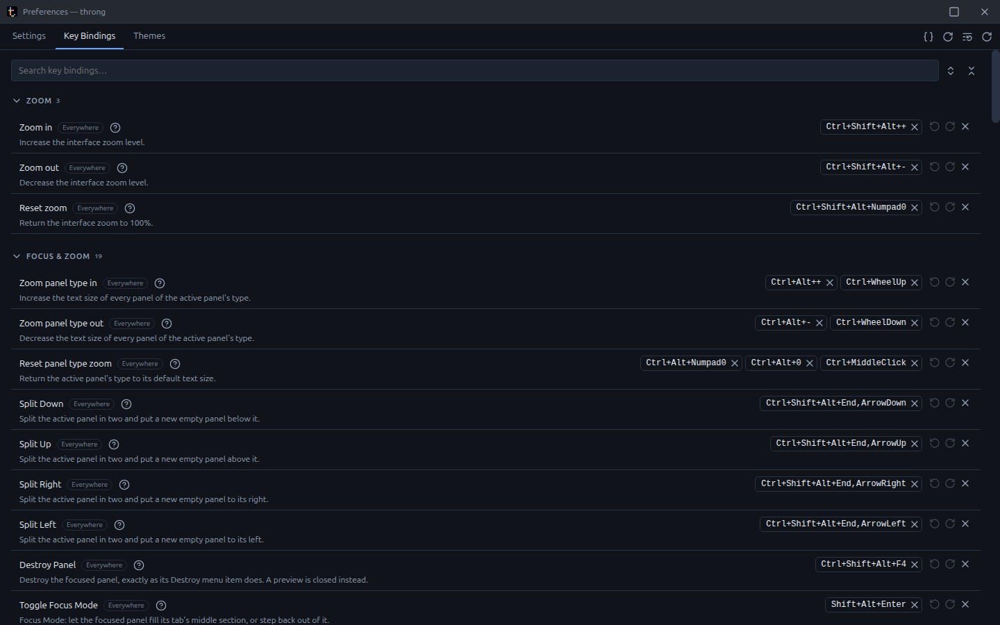

# Key bindings

Every command has a shortcut, and you can change any of them. Most of throng's own chords use
**Ctrl+Shift+Alt**, a corner of the keyboard your shell and your other tools leave alone, so the two don't
collide. The full list, command by command, is the [key bindings reference](../../docs/key-bindings.md).

> [!NOTE]
> On a Mac, read **Cmd** wherever this guide says **Ctrl**, and **Option** for **Alt**. A terminal still
> gets Ctrl. The few chords that differ are in [On macOS](../../docs/key-bindings.md#on-macos).

## Find the shortcut for something

**Cog menu › Key Bindings**

The Key Bindings tab lists every command with its chords and the places it works, such as an editor or
everywhere. Its search matches a command's name, its description and its chord, so you can look up a chord
to find out what it does.

1. Click the cog and choose **Key Bindings**.
2. Type part of the command's name into the search box.
3. Read its chord. The **?** beside its name opens its entry in the reference.

Resting the pointer on any button in throng also shows its shortcut.

## Change a shortcut

**Cog menu › Key Bindings › a command's chord**

You can give any command the keys your fingers already know from another editor. throng saves the change at
once, and every open window picks it up.

1. Click the command's chord.
2. Press the new one.
3. If another command already has it, throng names that command and offers **Reassign**.

You can remove a chord altogether, or add a second one, from the same row.

## Use two-key chords

**Anywhere**

A chord can have a second key after the first, the way **Ctrl+E**, **W** toggles word wrap. One easy prefix
then reaches several commands.

1. Press the first part, such as **Ctrl+E**, and let go.
2. Press the second, such as **W**.

The status bar shows that throng is waiting for the second key. Every multi-key chord is in
[Multi-key chords](../../docs/key-bindings.md#multi-key-chords).

## Know which keys always reach your shell

**Any terminal**

Your shell relies on a set of Ctrl keys for interrupting, editing the line and searching history. throng
leaves those to the terminal while it has focus.

1. Click into a terminal.
2. Use **Ctrl+C**, **D**, **Z**, **A**, **E**, **W**, **U**, **K**, **R**, **L** and **Q** as your shell
   expects: throng never takes them while a terminal has focus.
3. Press **F1** for your program's own help. In a terminal, F1 belongs to the program.

macOS differs a little; see [macOS](../../docs/macos.md).
