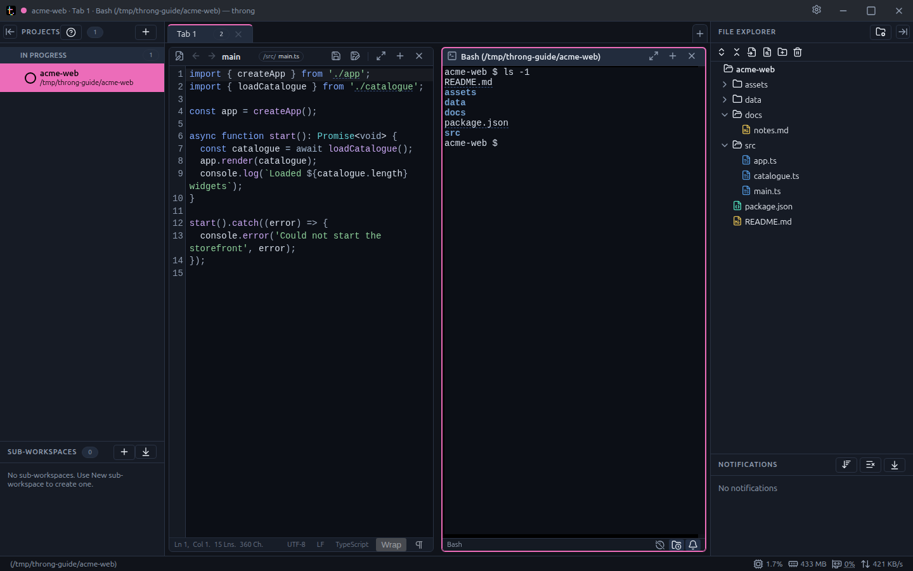
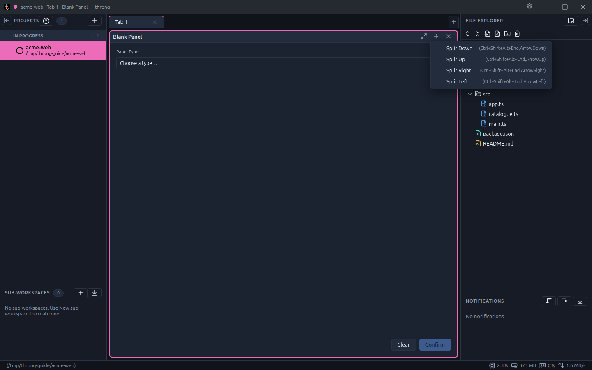

# Tabs, panels and layout

The centre of the window is a dock of tabs, and each tab holds panels. Arrange them however you work (an editor beside a terminal,
three terminals stacked, a preview on its own), and each project remembers
its own layout, splits, sizes and zoom included.

## Understand panes, tabs and panels

**The main window**

throng uses three words for the parts of its window, and the menus and this guide hold to them: a pane, a tab and a panel.

1. Find the three **panes**: Projects on the left, the workspace in the centre, and the File Explorer and
   Notifications on the right.
2. Look along the top of the workspace: those are its **tabs**.
3. Inside a tab are its **panels**. Each one is a terminal, an editor, a preview or a search.

## Choose what a panel shows

**A blank panel › Panel Type**

A new panel is blank until you give it a job: a terminal, an editor, a preview or a search.

1. Open the **Panel Type** drop-down on a **Blank Panel**.
2. Choose what it should be.
3. Click **Confirm**.

To start again, choose **Clear panel type** from the panel's menu; it goes back to blank.

## Add, rename, reorder and close tabs

**The tab strip along the top of the workspace**

Tabs keep separate jobs apart within one project, each with its own panels and layout.

1. Click **+** on the tab strip to add a tab. Where it lands is a [Tabs setting](../../docs/preferences.md#tabs).
2. Double-click a tab, or press **Ctrl+Shift+Alt+F2**, to rename it.
3. Drag a tab to reorder it.
4. Rest the pointer on a tab's close button, then click it to close the tab.

> [!NOTE]
> A tab's close button only acts once the pointer has rested on it, so a click in passing never closes a
> tab by accident.

## Find a tab when you have many

**The tab strip › ▾, or anywhere (Ctrl+Shift+Alt+T)**

The tab list finds any tab by name, however many the strip holds.

1. Click **▾** at the end of the tab strip, or press **Ctrl+Shift+Alt+T**.
2. Type part of the tab's name.
3. Pick it with the arrow keys and **Enter**.

A crowded strip also scrolls, with arrows and counts at either end, and resting on a tab shows its popover.

## Split a panel

**A panel's header › +, or anywhere (Ctrl+Shift+Alt+End, then an arrow)**

Splitting a panel gives you two in its place, side by side or one above the other.

1. Click **+** in the panel's header.
2. Choose **Split Down**, **Split Up**, **Split Right** or **Split Left**.
3. Give the new, blank panel its job.

> [!TIP]
> From the keyboard, press **Ctrl+Shift+Alt+End**, let go, then press an arrow: the split goes that way.

## Resize panels and side panes

**The divider between two panels or panes**

Dragging a divider gives one panel or pane more room at its neighbour's expense.

1. Point at the divider until the pointer changes.
2. Drag it.

Each side pane's widest size is a [Window setting](../../docs/preferences.md#window).

## Rearrange panels by dragging

**A panel's header › drag**

You can drag any panel to a new place in its tab, or into another tab, by its header.

1. Drag a panel by its header.
2. Drop it on another panel's edge to dock it there, or on its centre to stack the two.
3. Drop at the very edge of the panel area to run the whole length of that side.
4. To move it to another tab, hold it over that tab until it switches, then drop.

Press **Esc** to cancel a drag.

## Move a panel to another tab

**A panel's menu › Send to Tab**

Send to Tab moves a panel, still running, into another tab.

1. Right-click the panel.
2. Choose **Send to Tab** › and the tab.

Or drag the panel onto a tab, or onto the tab strip's **+** to give it a new tab of its own.

## Concentrate on one panel

**A panel's header › ⤢, or anywhere (Shift+Alt+Enter)**

Focus Mode gives one panel the whole tab, with the side panes folded away, until you leave it.

1. Click **⤢** in its header, choose **Enter Focus Mode**, or press **Shift+Alt+Enter**.
2. The tab's other panels hide and both side panes fold away.
3. Do the same again, or press **Esc**, to put everything back.

While a panel is in Focus Mode its status bar is highlighted and names the mode, with the key that leaves it. Terminals
do this too when their status bar is shown.

## Zoom text in panels or the whole window

**Anywhere**

Panel zoom changes the text size of every panel of one type. Window zoom scales the whole window.

1. Press **Ctrl+Alt++** or **Ctrl+Alt+-** (or **Ctrl+wheel**) to zoom panels of the focused panel's type.
2. Press **Ctrl+Shift+Alt++** or **Ctrl+Shift+Alt+-** to zoom the whole window.
3. Press **F11** for full screen (macOS: **Ctrl+Cmd+F**).

Every zoom chord is in the [Zoom reference](../../docs/key-bindings.md#zoom).

## Show and hide the side panes

**Each pane's arrow button, or anywhere (Ctrl+Shift+Alt+J / K)**

Each side pane folds to a slim rail, leaving its width to the workspace.

1. Click the arrow on a side pane to collapse it, or press **Ctrl+Shift+Alt+J** (Projects) or
   **Ctrl+Shift+Alt+K** (File Explorer).
2. A collapsed pane becomes a slim rail with a summary; click it to open the pane again.

On a narrow window the panes fold away by themselves. Each project remembers which are open.

## Move around with the keyboard

**Anywhere**

Every move between panels, panes and menus has a chord, so you can leave the mouse alone.

1. Press **Ctrl+Shift+Alt+Arrows** to move to the panel in that direction.
2. Press **Ctrl+`** to cycle through panels.
3. Press **Ctrl+Shift+Alt+B**, **N** or **M** to jump to Projects, the workspace or the File Explorer.
4. Press **Shift+F10** to open the menu for whatever has focus.

**Tab** and **Shift+Tab** move between the controls of the panel you are in and stop at its edges; they never
take you to another panel.

See [Focus & Zoom](../../docs/key-bindings.md#focus--zoom) for the rest.

## Close a panel

**A panel's menu › Destroy Panel, its header ✕, or Ctrl+Shift+Alt+F4**

Destroying a panel removes it from its tab, and ends a terminal's program with it.

1. Choose **Destroy Panel** from the panel's menu, click **✕** in its header, or press
   **Ctrl+Shift+Alt+F4**.
2. Confirm if asked. Which actions ask first is a [Confirmations setting](../../docs/preferences.md#confirmations).

> [!WARNING]
> Destroying a terminal panel ends whatever is running in it. Previews and panels shown in another window
> offer **Close** instead, which leaves the original alone.

## Read a panel's header

**The strip along the top of every panel**

A panel's header names what it is and shows whether it needs you.

1. Read the type icon and the title.
2. Look for the file it shows, an unsaved dot, an attention mark and, for an elevated terminal, **ADMIN**.
3. On an editor or a preview, the first two buttons open the file in your system's default program and find it in
   the File Explorer. They are greyed out, with the reason on hover, while the document has no file.

On a narrow panel the less important controls give way first; every one stays on the panel's menu.

## When a panel fails

**The failed panel's banner**

A panel that fails shows a banner with the reason and a way to try again.

1. Read the banner.
2. Click **Try again**.
3. If it fails again, click **Copy details** for a bug report, or **Clear panel type** to start afresh.
