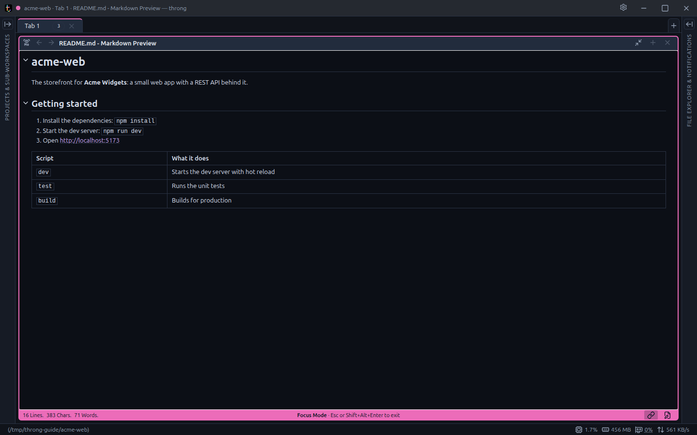

# Markdown

The Markdown preview renders GitHub-flavoured Markdown with the Obsidian extras on top: callouts,
wikilinks, maths and Mermaid diagrams. Write your README, your notes or a whole vault in the editor, and
read it properly in the preview beside it.

## Write Markdown and see it rendered

**File Explorer › click a `.md` file, or an editor's status bar › Open Preview**

The Markdown preview shows a document the way a reader will see it. Beside an editor on the same file, it redraws as you type and scrolls with you.

1. Open the Markdown file. By default it opens in the preview; open it in an editor too to write.
2. Put the two side by side and type. The preview follows.



Tables, links, raw HTML, `<details>` blocks and coloured code blocks all render. Words matching the one
under the caret are highlighted.

## Tick off task lists

**The Markdown preview › a task's checkbox**

A task list in the preview has real checkboxes. Ticking one writes the change to the file, so you keep a checklist current without editing the text.

1. Write tasks as `- [ ] Do the thing`.
2. Click a task's checkbox in the preview.

The file changes, and an open editor shows the change at once and can undo it.

## Add callouts

**The editor › a blockquote starting `[!type]`**

Callouts draw a note, tip or warning as a coloured box, in the Obsidian syntax. Each type has its own colour, and a callout can fold.

1. Start a blockquote with `> [!note]`, `> [!tip]`, `> [!warning]` or another Obsidian type.
2. Write the callout's text on the following `>` lines.
3. (Optional) Use `[!type]-` to start it folded, or `[!type]+` to make it foldable but open.

## Write maths

**The editor**

The preview typesets TeX maths, inline or on lines of its own, so equations sit in your notes as they would in a paper.

1. Wrap inline maths in `$…$`.
2. Put display maths in `$$…$$` on its own lines, or in a `math` code block.

A malformed expression shows its source, with the error when you hover over it.

## Draw diagrams with Mermaid

**The editor › a `mermaid` code block, or a `.mmd` file**

Mermaid diagrams are text, so they live in the repository beside the docs they illustrate and change in the same commit. The preview draws them.

1. Write a code block fenced with ` ```mermaid `, or a `.mmd` / `.mermaid` file.
2. The preview draws it as its diagram.
3. Use the buttons at the diagram's top left to fit, zoom and focus it.

To embed a diagram file, write `![[flow.mmd]]`; to give an inline diagram a height, add `height=300`.

## Link notes together

**The editor › `[[wikilinks]]`**

Wikilinks join notes the way Obsidian does. throng resolves a link by note name, alias, heading or block, anywhere in the project.

1. Write `[[Note name]]` to link another note.
2. Add an alias, a heading or a block reference as you would in Obsidian, or a vault-root path such as
   `[[Docs/Guide]]`.
3. Click the link in the preview, or **Ctrl+click** it in the editor, to follow it.

## Add and size images

**The editor**

Images embed with the Obsidian or the Markdown syntax, and either can set a width, or a width and a height.

1. Embed an image with `![[diagram.png]]`.
2. Add `|300` for a width, or `|300x200` for both sides.

A Markdown image takes a size the same way: ``.

## Show front matter

**The top of a Markdown file**

YAML front matter at the top of a file shows in the preview as a table, so a note's metadata is readable at a glance.

1. Put YAML front matter between `---` lines at the top of the file.
2. The preview shows it as a table.
