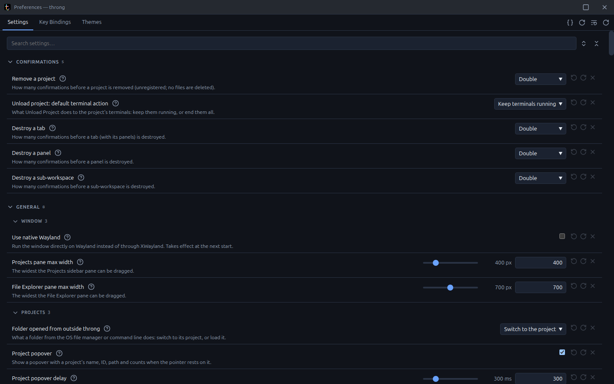

# Preferences

You change every setting, key binding and theme in the preferences window, and each change applies the
moment you make it, with no restart and no Apply button. Each setting has a one-line description there, and
a **?** beside its name that opens its full entry in the [preferences reference](../../docs/preferences.md).

## Open Preferences

**Cog menu › Settings**

The preferences window has three tabs: **Settings**, **Key Bindings** and **Themes**. It floats above
throng without blocking it, so you can watch a change land while you make it.

1. Click the cog at the top right of the window.
2. Choose **Settings**. On macOS, **Cmd+,** gets you there too.

A notice about a setting can open Preferences at that setting for you.

## Find a setting

**Preferences › Settings › the search box**

The search box matches a setting's name, key, description and value, and the headings above it. The best
match comes first.

1. Type part of the setting's name, or its key, into the search box.
2. Sections fold as you go; **Expand All** and **Collapse All** open or close them all.
3. Click the **?** beside a setting's name to read its full entry in the reference.

## Change a setting

**Preferences › Settings**

A toggle or a drop-down applies the moment you change it. A typed value applies when you press **Enter** or
leave the box.

1. Find the setting.
2. Change its value.

A number outside its range turns the box red, and a notice gives the range.

## Undo a change, or go back to the default

**Preferences › a setting's Revert, Reset or Clear**

Each setting row has three ways back. **Revert** undoes what you changed this session, **Reset** returns
to throng's default, and **Clear** empties a list.

1. Click **Revert** to undo your change from this session.
2. Click **Reset** to go back to throng's default.
3. Click **Clear** to empty a list.

The toolbar's **Revert All** and **Reset All** do every setting at once.

> [!WARNING]
> **Reset All** puts every setting back to its default, and you cannot undo it.

## Edit lists and tables

**Preferences › a list or table setting**

A setting that holds a list, such as excluded globs, shows a summary in its row. Its edit button opens the
whole list in a window of its own.

1. Click the list or table setting's edit button.
2. Its own editor window opens. Add, change, reorder or remove entries there.

## Edit the settings as JSON

**Preferences › JSON**

The JSON view edits the same settings file in throng's own editor, which suits a change to many settings at
once. throng applies the document when you leave the view.

1. Open the **JSON** tab. It shows the settings file.
2. Edit it. throng marks an invalid value where it sits.
3. Save, or click **Discard** to drop your edits.

## Edit config files by hand

**Your config folder (see [Where the files live](../../docs/preferences.md#where-the-files-live))**

throng keeps settings, key bindings and themes in plain JSON files, so they can live in your dotfiles. It
reloads a file as soon as you save it.

1. Open the settings file in any editor, throng's included.
2. Change it and save.

Where each file lives on each system is in [Where the files live](../../docs/preferences.md#where-the-files-live).

## What happens to your settings on upgrade

**Installing a new version**

An upgrade keeps your choices. throng adds new settings with their defaults and leaves each value you set.

1. Install the new version as usual.
2. Open Preferences: anything new shows its default, and your own values are as you left them.

## Choose whether throng asks before opening a link

**Cog menu › Settings › Confirmations › Ask before opening external links**

Before throng sends a link to your browser or another app, it shows the whole address and asks. That catches
a link you clicked by accident, and one that goes somewhere other than its text suggests. It covers every link
that leaves throng: terminals, editors, previews, About and the Help window.

1. Follow a link. The prompt shows its address.
2. Click **Open** to go there, or **Cancel** (or press **Esc**) to stay.
3. To stop the prompt, click **Change in Preferences** on it, then turn off **Ask before opening external
   links**.

> [!NOTE]
> The prompt is on until you turn it off. A file a link opens inside throng never asks.
