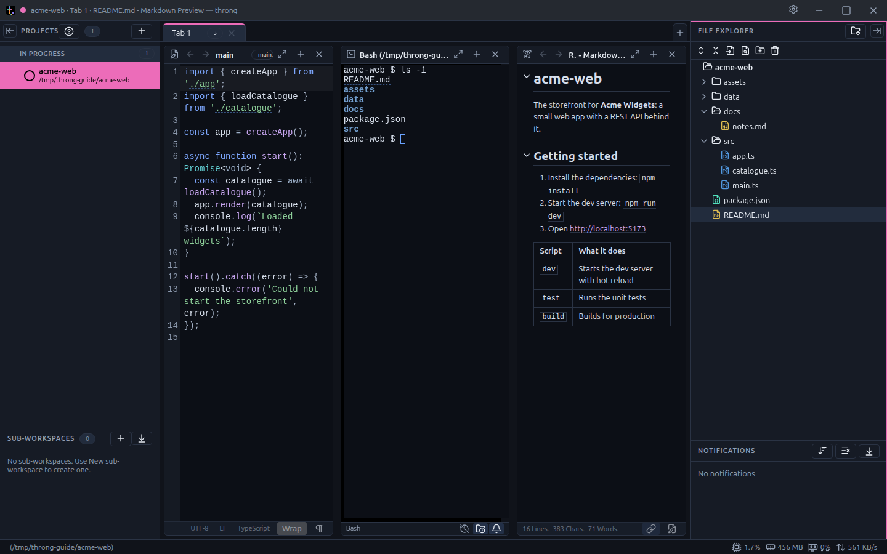

# Previews

A preview shows a file rendered, the way it is meant to be read: Markdown, Mermaid diagrams, CSV grids,
spreadsheets, images, PDFs, SVG and HTML. Put one next to the editor and it follows your typing, which
beats flicking to a browser every thirty seconds. Preview settings are in the
[Previews reference](../../docs/preferences.md#previews).

## Open a preview of a file

**An editor's status bar › Open Preview, a file's menu › Open Preview, or drop a file on a preview**

A preview opens in a panel of its own, titled with the file's name and the preview type. You can open one
from the editor, from the File Explorer, or by dropping a file on a preview you already have.

1. Click **Open Preview** on the editor's status bar.
2. Or right-click the file in the File Explorer and choose **Open Preview**.
3. Or drag a file onto a preview panel.

If the file already has a preview, **Open Preview** takes you to it rather than opening a second.

## Choose what opens when you open a file

**Cog menu › Settings › Editor › Previews**

Each file type has a default open action: the editor, a throng preview or your system's own program. A
click in the File Explorer or a followed link uses it.

1. Open [Previews](../../docs/preferences.md#previews) in Settings.
2. For each file type, choose the editor, a throng preview or your system's own program.
3. Choose whether opening another file reuses the preview you already have.

## Keep a file and its preview in step

**A preview beside its editor**

A preview beside its editor redraws as you type and scrolls with the editor, so the part you are writing
stays in view in both.

1. Open the file in an editor, and its preview in a panel beside it.
2. Type: the preview follows, and scrolls with you.
3. Click **Open in Editor** in the preview to jump back to the source.

## Move around a preview

**A preview**

A preview keeps a Back and Forward history like a browser, and offers a Go to list for its content:
headings in Markdown, pages in a PDF, rows in a CSV.

1. Press **Ctrl+G** for Go to Heading (Go to Page in a PDF, Go to Row in a CSV).
2. Press **Alt+Left** and **Alt+Right** to step back and forward.
3. Drag with the middle mouse button to scroll. Zoom as you would any panel.

## Copy from a preview

**A preview › right-click**

You can paste rendered content into another program, keeping its formatting, or as plain text. Pictures
and diagrams copy as images.

1. Select what you want, then right-click.
2. Choose **Copy**, or **Copy as** › **Rich Text** or **Plain Text**, or **Copy Path**.
3. For pictures and diagrams, choose **Copy Image**.

## Print a preview or save it as a PDF

**A preview › Ctrl+P**

Print Preview shows each page as it will print, with the printer, paper and layout controls beside it. The
same window saves a PDF when you want to send the document to someone.

1. Press **Ctrl+P**. Print Preview opens.
2. Choose the printer, paper, orientation, margins, fit, header and footer.
3. Check each page in the preview.
4. Click **Print**, or **Save as PDF…**.

> [!NOTE]
> The printout matches the pages shown, on white paper, whatever theme you use.

## When a preview cannot show a file

**The banner across the preview**

A preview that cannot show a file puts a banner across itself naming the reason, such as a file over the
size limit or one it cannot read.

1. Read the banner: it gives the reason.
2. Fix the cause, then click **Refresh**.

Size limits, and turning a preview type off altogether, are [Previews settings](../../docs/preferences.md#previews).
