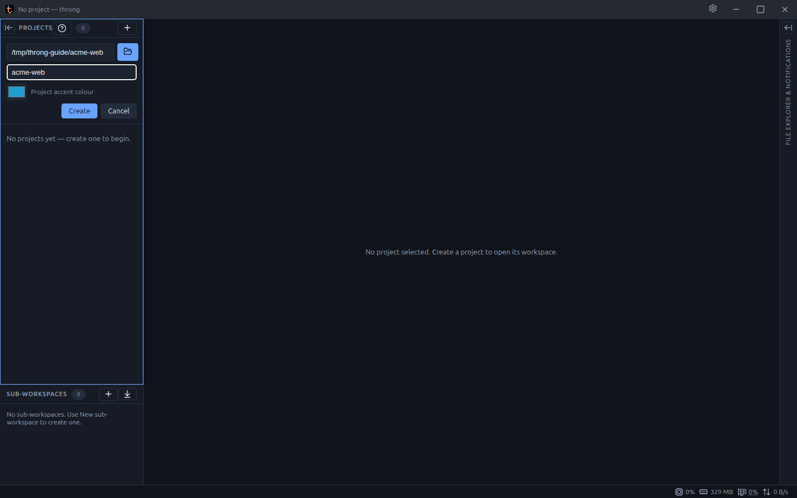

# Projects

A project is one root folder, one colour and one workspace. throng saves each project's tabs, panels and
terminals, and puts them all back when you return to it. Switching between pieces of work costs you a
click, and no rearranging of windows. The Projects pane on the left lists them all.

## Add a project

**Projects pane › + in its header**

A new project takes a folder, a name and a colour. throng suggests the name from the folder, and gives the project an empty workspace of its own.

1. Click **+** in the Projects header.
2. Choose the project's folder.
3. Accept the suggested name and colour, or change them.
4. Click **Save**. The project opens with an empty workspace, ready to fill.

> [!NOTE]
> Projects cannot overlap or nest: a folder can only belong to one. Where the folder picker starts is a
> [Projects setting](../../docs/preferences.md#projects).

## Open a folder as a project from your file manager

**Your file manager › right-click a folder › Open as throng project**

throng can add an **Open as throng project** item to your file manager, so you start work on a folder from where you found it.

1. Right-click the folder in your file manager.
2. Choose **Open as throng project**. It is there on Windows, in Nemo, Dolphin and GNOME's **Open With** on
   Linux, and from the Dock or **Open With** on macOS.

To add or remove that entry, use **Settings** › **General** › **File Manager**.

## Open a folder as a project from the command line

**Any terminal › `throng <path>`**

The `throng` command opens a folder as a project from any terminal, including the one already sitting in it.

1. Run `throng .` (or `throng <path>`).
2. A throng that is already running takes it over. A folder inside an existing project selects that
   project instead of making a new one.

Whether throng switches to it or only loads it is the **Folder opened from outside throng** setting.

## Switch between projects

**Projects pane, or anywhere (Ctrl+Shift+Alt+PageDown / PageUp)**

Each project keeps its own tabs, panels and focus, so switching away and back puts you where you were.

1. Click a project in the Projects pane.
2. Or press **Ctrl+Shift+Alt+PageDown** for the next project and **Ctrl+Shift+Alt+PageUp** for the previous
   one, from anywhere.
3. Choosing from the list keeps focus there, so the arrow keys and **Enter** carry on from the keyboard.

## Rename a project, change its colour or move its folder

**Projects pane › right-click a project › Edit**

You can rename a project, recolour it or point it at another folder at any time. Its tabs and terminals stay as they are.

1. Double-click a project to rename it in place.
2. For its colour or folder, right-click it and choose **Edit**.
3. Change what you need and save.

Rest the pointer on a project for its popover: full name, ID, path, and how many tabs and panels it has.

## Group projects into categories

**Projects pane › right-click a project › Move to Category › New Category…**

Categories group projects in the Projects pane, such as work in progress, work waiting on someone, and finished work.

1. Right-click a project.
2. Choose **Move to Category** › **New Category…**.
3. Name the category. The project moves into it.

Every project starts in **In Progress**.

## Fold, rename, reorder and delete categories

**Projects pane › a category header's menu**

A category folds to its header, so a long list stays short. Each header has a menu for folding, renaming and deleting.

1. Open the category header's menu to fold, rename or delete it.
2. Drag a header up or down to reorder the categories.

A folded category still lists the projects you have loaded, so open work stays one click away.

## Reorder your projects

**Projects pane › drag a project's row**

You choose the order of the Projects pane by dragging, within a category or into another one.

1. Drag a project by its row.
2. Drop it where you want it, in the same category or another one.
3. Changed your mind mid-drag? Press **Esc**.

## Unload a project you are not using

**Projects pane › right-click a project › Unload**

Unloading a project closes its tabs and keeps their layout for next time. You choose whether its terminals keep running or end.

1. Right-click the project.
2. Choose **Unload**. The item names what happens to its terminals, keep running or end; the second
   **Unload** item does the other.

The default is a [Projects setting](../../docs/preferences.md#projects).

## Remove a project

**Projects pane › right-click a project › Remove**

Removing a project takes it out of throng, with its saved layout.

1. Right-click the project.
2. Choose **Remove** and confirm.

> [!NOTE]
> Removing a project deletes nothing on disk. Its folder stays where it was.

## Open a project's folder or copy its path

**Projects pane › right-click a project**

The project menu opens the folder in your OS file manager or copies its path, for the tools outside throng.

1. Right-click the project.
2. Choose **Open in OS Explorer**, or **Copy Path** › and the Windows or POSIX form.

Both work whether the project is loaded or not.

## Hide files in one project, or keep them out of its searches

**File Explorer › right-click a file or folder**

Each project can hide files from its File Explorer, or keep them out of its searches, without changing any other project.

1. Right-click the file or folder in the File Explorer.
2. Choose **Hide in this project** or **Exclude from Find in Files in this project**.
3. To undo either, open the project settings from the File Explorer's cog; it lists both.

## Read a project's row at a glance

**Projects pane**

Each row in the Projects pane shows whether the project is loaded, has unsaved changes, or has panels waiting for you.

1. The active project is filled with its colour; an unloaded one is dimmed.
2. A dot means unsaved changes.
3. An attention mark replaces the colour dot when a panel in it needs you, and count pills show how many
   are waiting. See [Attention](attention.md).
