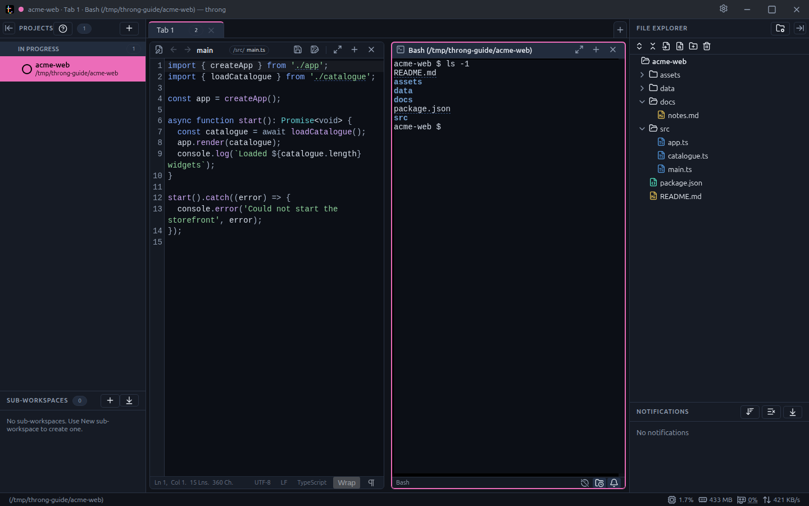

# Quick start

From first launch to a working project in about ten minutes. Every shortcut here can be changed; the
full list is in the [key bindings reference](../../docs/key-bindings.md).

## Install throng

**Your browser, then your system's installer**

throng installs like any other desktop app on Windows, Linux and macOS. Each system has a page of its own with the details.

1. Follow the guide for your system: [Windows](../../docs/install-windows.md), [Linux](../../docs/install-linux.md) or
   [macOS](../../docs/install-macos.md).
2. Start throng. To see which version you have, open the cog menu at the top right and choose **About throng**.

> [!NOTE]
> On macOS, throng is checked by automated tests only. Please
> [report](https://github.com/Bidthedog/throng/issues) anything that looks wrong on a Mac.

## Find your way around the window

**The main window**

The window has three panes: your projects on the left, your work in the middle, and the project's files on the right. Everything else hangs off the cog menu in the title bar.

1. Look at the left pane, **Projects**: your projects, their categories and any windows you tore off.
2. Look at the centre, the **workspace**: tabs of panels, each a terminal, an editor, a preview or a search.
3. Look at the right pane: the **File Explorer** for the active project, with **Notifications** below it.
4. Collapse a side pane to a rail with the arrow at its edge, or press **Ctrl+Shift+Alt+J** (left) or
   **Ctrl+Shift+Alt+K** (right).
5. Open the **cog menu** in the title bar for Settings, Key Bindings, Themes, the Resource Monitor, Help and
   About.

The status bar at the bottom shows what throng is using; each panel has a status bar of its own.

## Add your first project

**Projects pane › + in its header**

A project is one folder, one colour and one saved layout, so each piece of work
keeps its own terminals and files.

1. Click **+** in the Projects header.
2. Choose the project's folder.
3. Accept or change the suggested name and colour, then confirm.

Projects cannot overlap or nest. Removing a project from throng never deletes anything on disk.

## Open a terminal in your project

**A blank panel › Panel Type › Terminal**

A terminal opens in the project's folder, and keeps running even when you close
throng.

1. In the empty panel, open **Panel Type** and choose **Terminal**.
2. Choose a **flavour**: the shells throng found on your system, such as PowerShell, Git Bash, bash or zsh.
3. Optionally type a **Startup Command**, such as `npm run dev`.
4. Click **Confirm**.

## Open and edit a file

**File Explorer › click a file**

throng's editor opens beside your terminals, so you can change a file and run it without switching app.

1. Click a file in the File Explorer. It opens in the last editor you used, and that panel flashes.
2. Edit it.
3. Press **Ctrl+S** to save. **Ctrl+Shift+S** saves everything.

> [!TIP]
> With nothing selected, **Ctrl+X** cuts the whole line.

## Split the workspace and add a tab

**A panel's header › +, and the tab strip's +**

Put a terminal, an editor and a preview side by side, or keep separate jobs on
separate tabs.

1. Click **+** in a panel's header and choose **Split Right** (or Down, Up or Left). A new empty panel
   appears on that side.
2. Choose what the new panel shows from its **Panel Type**.
3. Click **+** on the tab strip to add a tab.
4. Drag a panel's header onto another panel's edge to move it there.

Your layout is saved per project and comes back next time you open it.

## Where to go next

**This guide**

Each area of throng has a page of its own. These four cover what most people reach for next.

1. Read [Terminals](terminals.md) to choose shells, reuse commands and keep sessions running.
2. Read [Knowing when something needs you](attention.md) to have terminals tell you when they finish.
3. Read [Files](files.md) and [Editing](editing.md) for the File Explorer and the editor.
4. Make throng yours in [Preferences](preferences.md), [Themes and icons](themes-and-icons.md) and
   [Key bindings](key-bindings.md).
