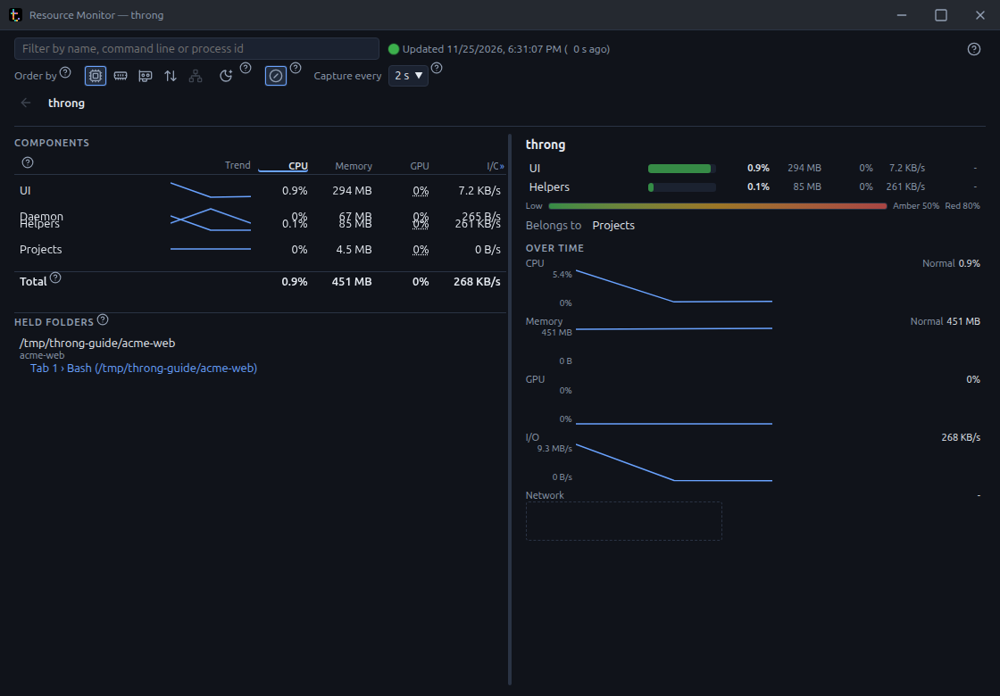

# Watching resources

Run enough terminals and sooner or later something eats a core or a few gigabytes. throng shows what it,
and everything its terminals run, is using, and lets you deal with it without opening Task Manager. How
it measures is in the [Resource Monitor reference](../../docs/preferences.md#resource-monitor).

## Find your way around the Resource Monitor

**Cog menu › Resource Monitor**

The Resource Monitor lists throng's own parts and every process your projects started, with their CPU, memory, GPU and I/O. A filter and a toolbar sit above the list, and a detail column beside it graphs the selected row over time.

1. Use the top row: the filter on the left keeps only the processes whose name, command line or process
   id matches, shown under their parents; **Updated** says when the figures were last captured.
2. Use the toolbar below it to choose what the list is ordered by, what it hides and how often it
   captures.
3. Read the left column: throng's own parts under **Components**, and your work under **Projects**. Click a
   row to select it; double-click to open it.
4. Read the right column: it describes the selected row, or the level the left column shows, and graphs
   each of its figures over time.
5. Use the **?** beside a control to open the part of this guide that explains it.

> [!NOTE]
> The figures show how throng's parts compare with one another. Treat them as a guide to scale.

## See what throng is using

**The right-hand end of the status bar**

The status bar shows throng's totals at all times, so you spot a runaway process before the machine slows down.

1. Glance at the figures on the right of the status bar: throng's total **CPU**, **memory**, **GPU** and
   **I/O**.
2. A figure that passes its warning or critical level changes colour.
3. Rest the pointer on them to see each figure split by part of throng.

## Find what is using the most

**Cog menu › Resource Monitor, the status bar figures, or anywhere (Ctrl+Shift+Alt+Y)**

The Resource Monitor ranks every process throng started by the figure you choose, and drills down from projects through tabs and panels to single processes.

1. Click the status bar figures, choose **Resource Monitor** from the cog menu, or press
   **Ctrl+Shift+Alt+Y**.
2. Click a column heading to order by it.
3. Type in the filter to narrow by name, command line or pid.
4. Double-click a row to drill down through projects, tabs, panels and processes.

## Stop something that is running away

**Resource Monitor › a row**

You can end a process, a whole tree, or unload or destroy the project or panel that started it, from the row itself.

1. Select the row.
2. Click **Kill**, **Kill All Below**, **Unload** or **Destroy**.
3. Confirm. Each one asks first.

> [!WARNING]
> **Kill** ends the process there and then, unsaved work and all.

## Choose what the list shows

**Resource Monitor › the toolbar**

The toolbar sets how the list is ordered, what it hides and how often throng takes a reading.

1. Pick a figure in **Order by** to rank the rows by it; it also sets the length and colour of the bars.
   Clicking a column's name does the same.
2. Turn on **Hide idle** to leave out processes doing almost nothing. One with a busy process under it
   stays, so every process still shows under its parent.
3. Leave **Hide ended** on to leave out processes that have ended, which is how it starts. Turn it off to
   see them greyed where they were.
4. Set **Capture every** to how often a reading is taken while the window is open. The history window sets
   the shortest interval allowed.

## See which folders throng is holding

**Resource Monitor › Held folders**

A folder that a terminal or another process has open cannot be deleted or moved until that process lets
go. The Held folders list shows which folders throng and its terminals hold.

1. Open the Resource Monitor.
2. Open **Held folders**: it lists the folders throng and its terminals have open.
3. Close or kill whatever is holding the one you need.

## Read the figures

**Resource Monitor**

A few marks tell you how far to trust a figure: whether throng measured it, estimated it, or could not
measure it at all.

1. Read **-** as "not measured": rest the pointer on it to see why. A **~** before a figure means it is an
   estimate.
2. Read the **Total** row as everything at this level, including processes a filter or a hide leaves out.
3. Check **Updated** to see when the figures were last captured.
