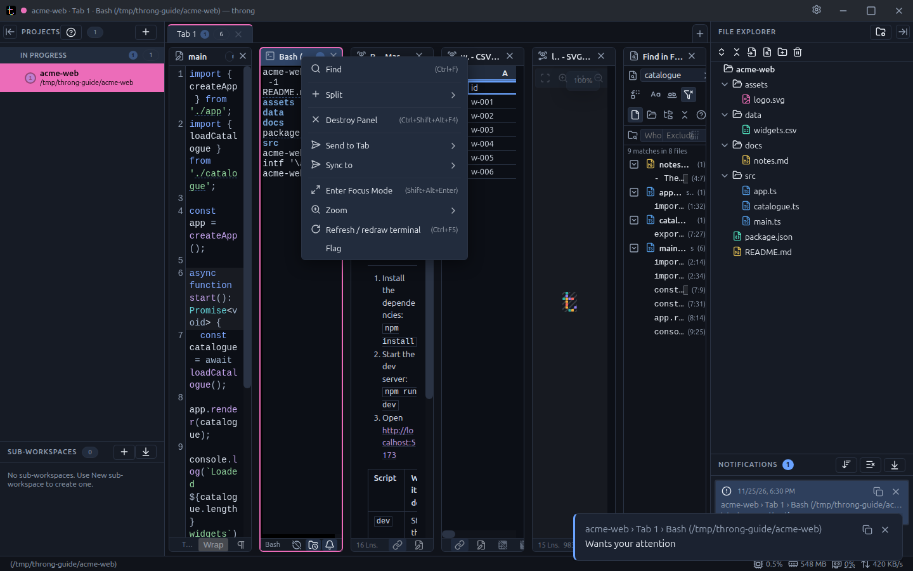

# More windows: sub-workspaces

A sub-workspace is another window onto the same project. Put your terminals on the second screen and your
editor on the first, or keep a build log in view while you work in another tab. Sub-workspaces are listed
under the project in the Projects pane, and come back with it.

## Tear a tab or panel off into its own window

**Drag a tab or a panel's header past the edge of the window**

You can move part of your work to another screen in one drag. The tab or panel keeps running while it
moves, so a terminal carries on with its scrollback intact.

1. Drag a tab, or a panel by its header, beyond the edge of the window.
2. A ghost window follows the pointer.
3. Let go where you want the new window. It becomes a sub-workspace of the project.

## Show a tab or panel in another window as well

**Right-click a tab or panel › Sync to**

A synced copy shows the same terminal or file in a second window. Type in either and both update, because
they are two views of one panel.

1. Right-click the tab or the panel's header.
2. Choose **Sync to** › and a sub-workspace, or **New Sub-workspace**.
3. The copy opens there, and names the project it belongs to.

> [!WARNING]
> **Close** on the copy removes the copy alone. **Destroy** removes the panel everywhere, terminal and all.

## Create and name a sub-workspace

**Projects pane › Sub-workspaces › +**

You can also start with an empty window and fill it as you go. Name it after the job it does, such as
"Logs", and the name shows in its title bar and in the Projects pane.

1. Click **+** in the **Sub-workspaces** panel under Projects.
2. Name it.
3. The new window opens, empty and ready for tabs.

## Reopen, rename, recolour, reorder or destroy a sub-workspace

**Projects pane › Sub-workspaces › its row**

Each sub-workspace has a row under its project. A closed one keeps its tabs and panels, ready for the next
time you open it.

1. Use the buttons on its row to reopen or destroy it.
2. Double-click its name to rename it, or click its swatch to recolour it.
3. Drag its grip to reorder the list.

Destroying a sub-workspace asks twice, because its panels go with it.

## Know how windows behave

**Any throng window**

throng's windows act as one app. Each comes forward by itself when you click it, and they open and close
together with the main window.

1. Click a window: it comes to the front on its own, without dragging the others with it.
2. Close the main window and the sub-workspaces close with it.
3. Reopen throng: each window comes back at its size and position.

> [!NOTE]
> On macOS, closing a window hides it, as Mac apps do.
