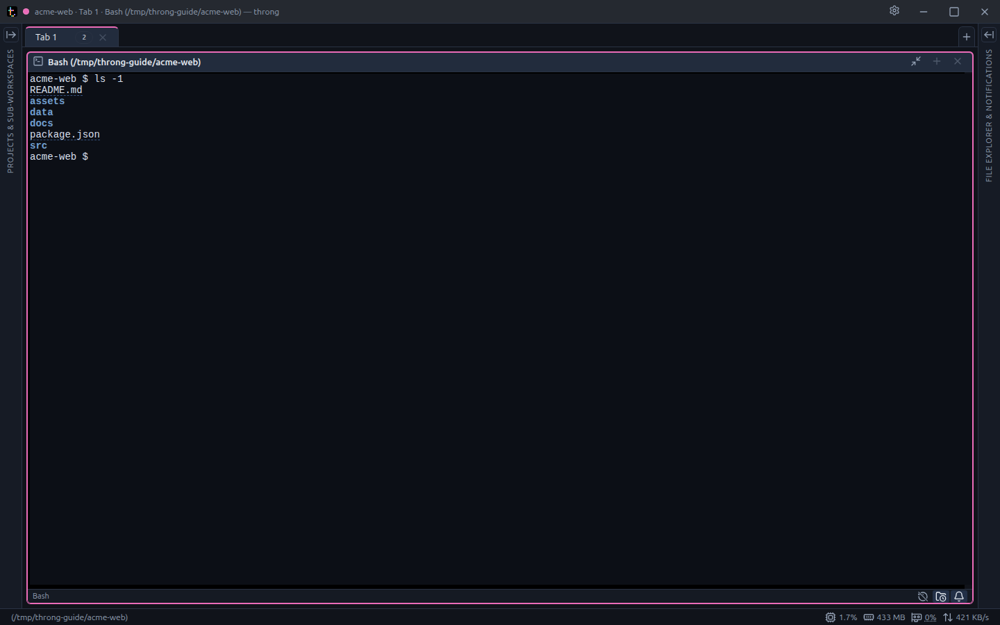
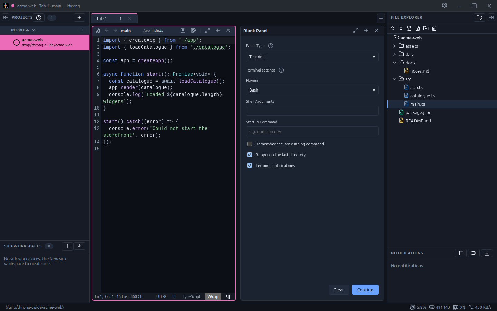

# Terminals

Every terminal in throng runs in its project's folder, belongs to a background service that outlives the
window, and keeps running when you close throng. You can set a build going, shut the lid and come back
to it later. Every terminal setting
is in the [Terminal reference](../../docs/preferences.md#terminal).

## Open a terminal

**A panel's Panel Type › Terminal, or File Explorer › right-click a folder › Open In › Terminal**

A terminal opens in the project's root folder, or in any folder of it you choose from the File Explorer.

1. In an empty panel, choose **Terminal** from **Panel Type**.
2. Pick a shell from the list (see the next task).
3. Click **Confirm**. The shell starts in the project's folder.

> [!TIP]
> To start in a sub-folder instead, right-click that folder in the File Explorer and choose **Open In** ›
> **Terminal**.

If throng finds no shells at all, the form tells you.

## Choose your shell

**A panel's Panel Type › Terminal › the shell list**

throng finds the shells installed on your system, such as PowerShell, Git Bash, bash and zsh, and lists each as a flavour.

1. Open the shell list on the terminal form.
2. Pick one. throng lists the shells it found on your system.
3. Click **Confirm**.

Built-in shells you never use can be hidden in [Preferences › Terminal](../../docs/preferences.md#terminal).

## Add a shell of your own

**Cog menu › Settings › Terminal › terminal flavours**

A flavour of your own runs a shell throng did not find, or a known one with the arguments you always use.

1. Open the cog menu and choose **Settings**.
2. Go to the **Terminal** section and add a custom terminal flavour.
3. Give it a name, the program to run and its default arguments.
4. Close Preferences. Your flavour now appears in every terminal form's shell list.

## Run a command when the terminal starts

**A panel's Panel Type › Terminal › Startup Command**

A startup command runs as soon as the shell is ready, such as a dev server or an agent.

1. Open the terminal form and pick a shell.
2. Type a **Startup Command**, such as `npm run dev`.
3. (Optional) Add any **Shell Arguments**.
4. Click **Confirm**. The command runs, and the shell stays open after it finishes.

## Reuse what you typed before

**A panel's Panel Type › Terminal › Startup Command or Shell Arguments**

The terminal form remembers the startup commands and shell arguments you have used, for each terminal type.

1. Click into **Startup Command** or **Shell Arguments**. throng lists what you typed there before for
   that terminal type.
2. Type to narrow the list, then pick one.
3. To forget an entry, highlight it and press **Delete**; **✕** beside the field forgets them all.

Preferences can clear the whole history too.

## Change how a terminal is set up

**Inside the terminal › type `exit`**

A terminal whose shell has exited shows its form again, so you can fix the startup command or pick another shell.

1. Type `exit` in the terminal (or end the shell however you normally would).
2. The terminal form comes back, filled in with what the terminal used.
3. Change what you need and click **Confirm**.

## Reopen in the folder you were last in

**The terminal's status bar › Reopen in the last directory, or the panel menu**

A terminal can reopen in the folder you were last in, in place of the project root.

1. Click **Reopen in the last directory** on the terminal's status bar. It brightens when it is on.
2. Next time the terminal starts, it opens in the folder you were last in.

> [!NOTE]
> PowerShell needs shell integration for throng to know which folder you are in. If the folder has been
> deleted since, the terminal opens at the project root instead.

## Pick up where you left off, including Claude Code sessions

**The terminal's status bar › Remember the last running command**

A terminal can remember the command it was running, and run it again when throng restarts, after a crash as well.

1. Click **Remember the last running command** on the terminal's status bar.
2. Run your command as usual.
3. When the terminal next starts, the command runs again by itself.

For Claude Code, throng remembers the command that resumes that exact session, so the conversation picks
up where it stopped, even after a reboot.

## Give terminals useful names

**Cog menu › Settings › Terminal › title templates**

A title template names each terminal from what it runs, so a dozen of them stay easy to tell apart.

1. Look at a terminal's tab: its name says what is running, the shell and the folder, such as
   `ping localhost -t | Git Bash (D:\git\throng)`.
2. To change that shape, open the [title templates](../../docs/preferences.md#terminal-title-templates) in
   Preferences and edit them.

A program that sets its own title always wins over the template.

## Copy, paste and drop paths

**Inside a terminal**

Copy and paste keep clear of the keys your shell uses, so moving text in and out never interrupts the running program.

1. Select text and right-click it, then choose **Copy**. **Ctrl+C** stays the interrupt key.
2. Paste with your system's terminal paste chord. A middle click never pastes.
3. Drag a file from the File Explorer into the terminal to type its path.

## Search what scrolled past

**Inside a terminal › Ctrl+F**

Find searches a terminal's scrollback, so you can find the one error in a long build log.

1. Click into the terminal and press **Ctrl+F** (macOS: **Cmd+F**).
2. Type what you are looking for.
3. Step through the matches with **F3** and **Shift+F3**; press **Escape** to close the find bar.

Find reads the scrollback and types nothing at the shell.

## Scroll, and know which keys reach the shell

**Inside a terminal**

A terminal keeps the mouse wheel and the keys your shell needs. throng takes a few chords of its own, all listed in the reference.

1. Scroll with the mouse wheel, or **Shift+PageUp** and **Shift+PageDown** a screen at a time.
2. Jump to the oldest line with **Ctrl+Home** and back to the newest with **Ctrl+End**.
3. In full-screen programs such as `vim` and `htop`, the program owns the keys and the wheel.

The reserved keys always reach the shell: see [Terminal bindings](../../docs/key-bindings.md#terminal) and
[Know which keys always reach your shell](key-bindings.md#know-which-keys-always-reach-your-shell).

## Follow links in terminal output

**Inside a terminal › Ctrl+click a path or URL**

throng finds file paths and URLs in terminal output. Ctrl+click opens a file at the line a compiler or Claude Code names, or a web page.

1. Hold **Ctrl** (macOS: **Cmd**) and click a path such as `src/foo.ts:42:7`, a URL or a hyperlink.
2. A project file opens in throng at that line; a web address opens in your browser.
3. For anywhere else it could open, right-click the link instead.

> [!NOTE]
> A click opens a link and never runs it.

## Clear and redraw

**Inside a terminal**

Your shell's clear command empties the screen and the scrollback, and a redraw chord repaints a program's screen that looks wrong.

1. Type `cls` (Windows) or `clear` to clear the screen and the scrollback.
2. If a program's screen looks garbled, press **Ctrl+F5** (macOS: **Shift+Cmd+F5**) to ask it to redraw. Nothing is lost.

## Keep terminals running after you close throng

**Anywhere › close throng**

Closing throng leaves its terminals running in the background service. The next start reattaches each one with its scrollback.

1. Close throng as normal. If any terminal is still busy, throng asks what to do with it.
2. Choose to keep it running.
3. Reopen throng later. Your terminals reattach with their scrollback intact.

## Start terminals only when you ask

**Cog menu › Settings › Terminal**

A project with many terminals can open without starting them, and start each one when you click its **Reload** button.

1. In [Preferences › Terminal](../../docs/preferences.md#terminal), set terminals to start manually.
2. Open the project. Each terminal waits with a **Reload** button.
3. Click **Reload** on the ones you want.

## Run a terminal as administrator (Windows)

**A panel's Panel Type › Terminal › Run as administrator**

On Windows, one terminal can run as administrator while the rest run as you.

1. Start throng itself as administrator.
2. On the terminal form, tick **Run as administrator**, then **Confirm**. The title shows **[ADMIN]**.

Terminals left unticked still run as you. Linux and macOS have no elevated terminals.

## Read the terminal status bar

**The bar along the bottom of a terminal panel**

The status bar along the bottom of a terminal panel shows its shell and its switches.

1. Read the flavour on the left.
2. Hover a link in the output: its target shows on the bar.
3. Use the three toggles: **Remember the last running command**, **Reopen in the last directory** and
   **Terminal notifications**. One that is on is bright; one that is off is greyed with a line through it.

## When a terminal will not start

**The terminal panel's banner**

A terminal that has not started shows why, and how to start it.

1. A terminal still starting shows that, with **Retry** if it is taking too long.
2. One that failed shows a banner with the reason; click **Try again**.
3. If its folder has gone, put it back: the terminal starts by itself when the folder returns.

Still stuck? See [Troubleshooting](troubleshooting.md).
