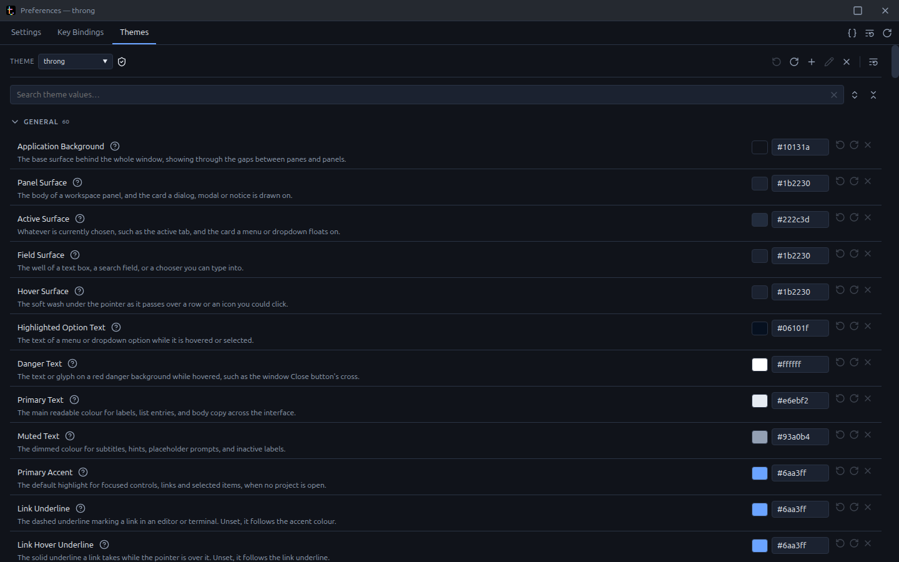

# Themes and icons

Every colour and icon in throng comes from a theme or an icon set, and you can change any of them. throng
ships fourteen themes, from the dark **throng** default to Light, Matrix and Cyberpunk. Every theme setting
is in the [theme settings reference](../../docs/theme-settings.md), and themes and icon sets as a whole in
[Themes and icon sets](../../docs/preferences.md#themes-and-icon-sets).

## Choose a theme

**Cog menu › Themes**

A theme sets the colours, fonts and sizes of every window throng opens. The one you pick applies at once,
across the main window, Preferences, the Resource Monitor and the Help window, and throng remembers it.

1. Click the cog and choose **Themes**.
2. Pick one of the bundled themes from the list at the top.

## Make your own theme

**Cog menu › Themes › Clone**

Bundled themes stay as they ship, so you make your own by copying one. Your copy keeps every colour of the
original until you change it, and an edit shows in the window as you make it.

1. Pick the theme closest to what you want, and click **Clone**.
2. Rename your copy.
3. Change its colours. Each one has a one-line description, and a **?** beside its name that opens its
   entry in the [theme settings reference](../../docs/theme-settings.md).

**Rename**, **Delete**, **Revert** and **Restore** manage your themes from the same tab.

## Check a theme is readable

**Cog menu › Themes › the contrast marks**

throng measures each pair of colours it draws together, such as text on its background, against the WCAG
AA contrast level. Every bundled theme passes. A theme of your own gets the same check as you edit it.

1. Look at the mark beside each colour pair.
2. A pair that misses WCAG AA shows a warning mark. Adjust one of its colours until the mark clears.

## Choose and customise icons

**Cog menu › Themes › icon set**

Every icon in throng comes from one icon set. The **throng** set ships with the app and stays as it is; a set
of your own can replace any icon with an SVG you supply.

1. Pick an icon set.
2. To change individual icons, create a new set and override any icon in it.
3. Click **Reset** on an icon to put it back.
