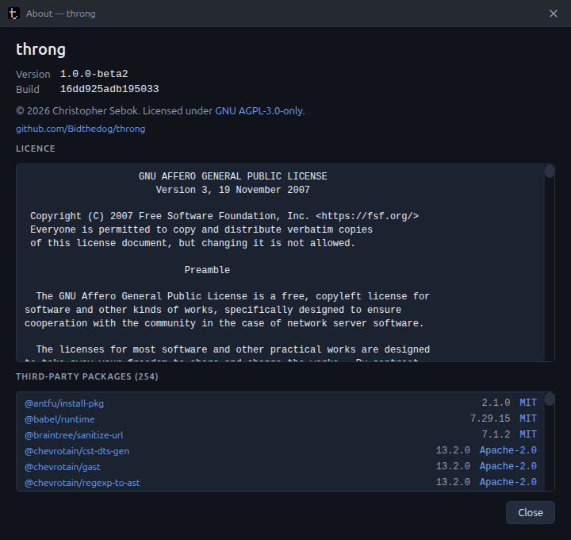

# Troubleshooting

Something not working? Start here. Each section names what you'll see and how to get going again. If none
of them fits, the last one explains how to report it.

## The background service has stopped

**The status bar › ↻**

Your terminals run in a background service, separate from the window. If that service stops, the status bar shows **↻**, and one click starts it again with your terminals reattached.

1. Look for **↻** on the status bar.
2. Click it. The service restarts and your terminals come back.

## A terminal will not start

**The terminal panel's banner**

A terminal that cannot start shows a banner across its panel with the reason, such as a shell that is no longer installed.

1. Read the banner on the panel.
2. Follow [When a terminal will not start](terminals.md#when-a-terminal-will-not-start).

## A file will not move, rename or delete

**The notice throng shows**

When a file will not move, rename or delete, another program or a terminal has it open. throng's notice names what holds it when the OS can tell.

1. Read the notice: it names what holds the file.
2. Follow [When a file will not move, rename or delete](files.md#when-a-file-will-not-move-rename-or-delete).

## Live updates stopped (Linux)

**The notice about the watch limit**

Linux limits how many folders one program can watch. When throng reaches that limit, the File Explorer stops following changes on disk and a notice explains how to raise it.

1. Read the notice.
2. Raise the limit as the notice and [Linux](../../docs/linux.md) explain.
3. Restart throng.

## throng says another copy is running

**Starting throng**

One throng runs at a time. Starting it again brings the open window forward.

1. Look for the window that is already open: opening throng again brings it forward.
2. If a notice says a different copy holds the background service, close that copy and try again.

Only one throng runs at a time. For more windows, use [sub-workspaces](sub-workspaces.md).

## throng says a newer version is installed

**The notice about the newer version**

When you install a new version while throng runs, the old copy keeps going and shows a notice. A restart moves you to the new version.

1. Read what the notice says will happen to your running terminals.
2. Restart throng to use the new version.

## throng will not start as root

**Starting throng on Linux or macOS**

throng will not run as root, because every file it touched would then belong to root.

1. Close the root shell you started it from.
2. Start throng as your own user.

## Find the logs

**Cog menu › Open Logs Folder**

throng writes logs of what it does to a folder on your machine. They stay there, with paths and names replaced by tokens.

1. Click the cog and choose **Open Logs Folder**.
2. Open the newest log.

How much gets logged is a [Logging setting](../../docs/preferences.md#logging).

## Report a problem

**Cog menu › About throng, then GitHub**

A report with the version, the steps and the logs is the one that gets fixed fastest.

1. Click the cog and choose **About throng**; note the version.
2. Grab the logs (see the previous task).
3. [Open an issue](https://github.com/Bidthedog/throng/issues) with the version, what you did, what you
   expected and what happened, and attach the logs.

> [!TIP]
> A failed panel's **Copy details** button copies everything a bug report needs about that failure.
